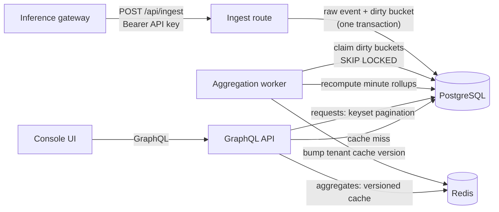

# Inference Developer Console

A developer console for an LLM inference API. Developers create projects and API keys, inspect individual inference requests, and track token usage, estimated cost, error rates, and latency.

**Stack:** Next.js (App Router), TypeScript, GraphQL (GraphQL Yoga), PostgreSQL, Redis


## Architecture



The write path and the read path are separate. Ingestion only appends raw events and marks which minute buckets changed. A background worker turns those marks into per-minute rollups. The dashboard reads rollups, with aggregate queries cached in Redis.

## Design decisions

### Raw events are the source of truth
`request_events` keeps every request. `metrics_minute` is derived data that can always be rebuilt from it. This makes rollups safe to recompute and lets correctness be tested by comparing the two (see tests).

### Idempotent ingestion
Gateways retry. `(tenant_id, request_id)` is unique and inserts use `ON CONFLICT DO NOTHING`, so a retried event is counted once. The response reports `accepted` and `duplicates` separately so the client can tell them apart. The first write wins. A retry with a different payload is ignored rather than merged.

Batches are inserted in a stable `request_id` order so concurrent batches that share IDs take index locks in the same order. Deadlocks and serialization failures still retry the whole transaction with backoff.

### Late events: recompute buckets instead of incrementing counters
Each accepted event marks its minute bucket as dirty, in the same transaction as the insert. The worker claims dirty buckets and recomputes each one from raw events. Because a bucket is fully recomputed, the worker is idempotent: a late event that lands in a bucket aggregated hours ago simply re-dirties it, and running the worker twice produces the same rows.

Counter increments would be faster but would double-count on retries and drift with no way to self-correct.

Events are accepted up to 7 days late, the window after which old buckets can be treated as final.

### Concurrency in the worker
- `FOR UPDATE SKIP LOCKED` lets several workers split the queue without blocking each other.
- Ingestion marks buckets with a locking upsert. If an ingest transaction holds a bucket's mark, workers skip that bucket until the events commit. If a worker holds it, ingestion waits, then re-inserts the mark after the worker's delete commits, so the bucket is recomputed again. Either way, no committed event is left unaggregated.

### A race the tests caught
The first version marked dirty buckets with `ON CONFLICT DO NOTHING`. The concurrent integration test, which compares rollups against an aggregate computed directly from raw events, failed on its first run: one bucket was missing a few events.

The cause: when a bucket was already marked, `DO NOTHING` skipped the insert without locking the existing row. A worker could then claim and recompute that bucket while the ingest transaction was still uncommitted, miss its events, and remove the mark. Once the ingest committed, nothing would ever recompute the bucket.

The fix is a no-op `DO UPDATE` that locks the existing mark. `marked_at` keeps its original value so a busy bucket isn't pushed to the back of the queue. The test now passes on 20 consecutive runs.

### Caching aggregates with version keys
Aggregate queries are cached for 60 seconds under keys that embed a per-tenant version. When the worker updates any of a tenant's buckets it increments that version, which makes all of the tenant's cached aggregates unreachable at once without scanning for keys. Ranges are snapped to whole minutes so repeated dashboard loads share cache entries. If Redis is unavailable, queries go to Postgres.

### Keyset pagination
Request listings page by `(started_at, id)` with an opaque cursor, backed by an index in the same order. Offset pagination slows down on deep pages and skips or repeats rows when new events arrive, both of which a live request log would hit constantly. Timestamps are stored at millisecond precision so they round-trip exactly through the cursor.

### Tenant isolation
Every SQL query starts from `tenant_id = $1`, and the tenant comes from the server-side session, never from a header or GraphQL argument. Mutations on projects and keys check tenant ownership in the same statement that writes. (For local development the session is stubbed with `DEV_TENANT_ID`.)

### Money as integers
Estimated cost is stored in integer micro-dollars and summed as integers, so totals don't drift from floating-point error.

### Percentiles
Counts, tokens, cost, and latency sums are additive across buckets, so they come from rollups. p95 latency is not additive, so it's computed from raw events for the requested range and cached. A histogram or t-digest per bucket would make this scale further; see below.

### API keys
Keys have 192 bits of randomness and are stored only as SHA-256 hashes. The full key is shown once, at creation. `last_used_at` is updated at most once a minute per key, off the request path, so a busy key doesn't become a hot row.

## Running locally

Requires Node.js 20+ and Docker.

```bash
cp .env.example .env
docker compose up -d
npm install
npm run db:migrate
npm run seed          # prints an API key for the demo project
npm run dev           # console at http://localhost:3000
npm run worker        # in a second terminal: background aggregation
```

Send an event:

```bash
curl -X POST http://localhost:3000/api/ingest \
  -H "Authorization: Bearer <api key>" \
  -H "Content-Type: application/json" \
  -d '{"requestId":"req_123","model":"llama-3.3-70b","status":"success","inputTokens":812,"outputTokens":240,"latencyMs":310,"startedAt":"2026-09-20T10:00:00Z"}'
```

`{"events": [...]}` sends up to 500 events in one batch.

## Testing

```bash
npm test
```

Unit tests cover validation, cost calculation, cursors, and series filling. Integration tests run against a real Postgres when `DATABASE_URL` is set (use a disposable database) and check:

- a retried event, and a duplicate within one batch, are counted once
- 50 concurrent submissions of the same event store one row
- a late event recomputes its original minute bucket, including events days old
- failed requests count toward the error rate
- under concurrent ingestion with racing duplicate IDs **while the aggregator is running**, rollups match an aggregate computed directly from raw events

### Load test

Run against a production build:

```bash
npm run build && npm start
npm run loadtest -- <api key> 200000 16 100
```

It reports throughput, batch latency percentiles, and how many events were accepted versus deduplicated. About 10% of events are deliberate retries.

Results on a MacBook Air, 16 concurrent clients sending batches of 100, 200,000 events per run (median of 3 runs):

| Throughput | p50 batch latency | p95 batch latency | Duplicates detected |
|---|---|---|---|
| ~81K events/s | 16 ms | 47 ms | ~10% (all deliberate retries) |

Each batch is one `unnest` insert in one transaction, so ~81K events/s is roughly 810 transactions/s. Throughput dropped slightly across consecutive runs as `request_events` grew, which is the motivation for daily partitioning below. These are single-machine, loopback-network numbers and don't represent production traffic.

## Limitations and next steps

- **Raw-event retention.** Raw events grow without bound. Next: partition `request_events` by day and drop partitions after a retention period, keeping rollups longer.
- **Percentiles at scale.** Store a fixed-bucket latency histogram per minute so p95 can be merged from rollups instead of scanning raw events.
- **Ingestion throughput.** Ingestion writes to Postgres synchronously. At higher volume, put a durable queue (e.g. Kafka) in front and batch inserts from consumers.
- **Coarser rollups.** Hourly rollups derived from minute rollups would keep 30-day queries cheap.
- **Auth.** Replace the dev tenant stub with real sessions and per-user roles.
- **Pricing.** Model prices are illustrative constants. A real system would version prices by effective date (see the companion billing service).